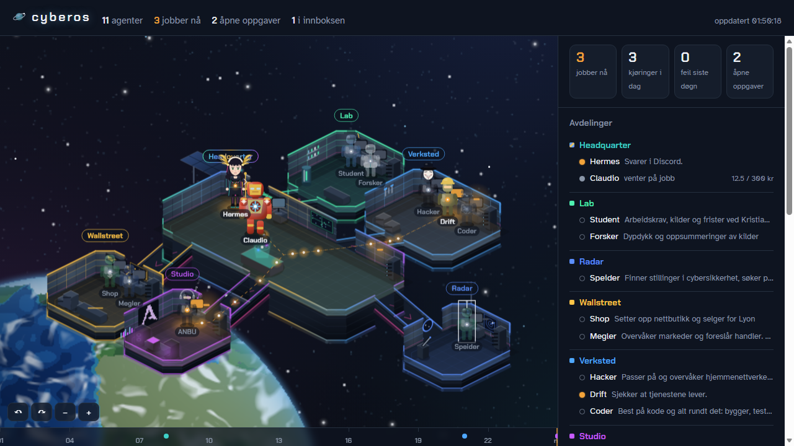

# cyberos

Et levende dashbord over AI-agentene dine. Agentene, oppgavene og kjøringene ligger som markdown-filer i en Obsidian-vault, og dashbordet leser rett fra vaulten. Ingen database og ingen synk.

Dashbordet viser agentene som et selskap på en romstasjon: hovedkvarteret i midten, avdelingene rundt, og lys bare der noe skjer.



## Kom i gang

```bash
python3 -m venv .venv && .venv/bin/pip install -r requirements.txt
.venv/bin/uvicorn app.main:app --port 8080
```

Åpne http://localhost:8080. Uten flere innstillinger viser dashbordet eksempeldataene i `eksempel-vault/`.

For å bruke din egen vault:

```bash
CYBEROS_VAULT=/sti/til/vaulten/din .venv/bin/uvicorn app.main:app --port 8080
```

## Mappene i vaulten

| Mappe | Hva | Frontmatter |
| --- | --- | --- |
| `Agenter/` | Én fil per agent. Legg gjerne ved `<navn>.png` med gjennomsiktig bakgrunn, så blir det figuren i stasjonen. | `rolle`, `status` (aktiv, venter), `verktoy`, `rom`, `kallenavn` (valgfri) |
| `Oppgaver/` | Sjekklister med `- [ ]` og `- [x]` | `eier`, `tildelt` |
| `Logg/` | Én fil per kjøring. Se `docs/logg-kontrakt.md`. | `agent`, `status` (ok, pågår, feil), `kostnad` |
| `Innboks/` | Åpne jobber. Jobber du sender fra dashbordet havner her. Ferdige flyttes til `Innboks/Ferdig/`. | `til`, `fra` |

## Gjør den til din egen

1. Kopier `eksempel-vault/` inn i din egen vault, eller start med en tom mappe med de fire undermappene.
2. Lag én fil i `Agenter/` for hver agent du har, og velg rom og rolle.
3. La agentene skrive logg etter kontrakten i `docs/logg-kontrakt.md`. Det er det dashbordet leser.
4. `hermes/innboks.md` er en oppskrift agenten din kan følge for å hente jobber fra innboksen. Koble den til agenten eller chatboten du selv bruker.

## Kjøre som tjeneste

`cyberos.service` er en systemd-mal. Bytt ut `DITT_BRUKERNAVN` og stiene, og legg den i `/etc/systemd/system/`. Sett `CYBEROS_DISCORD_WEBHOOK` i tjenestefila hvis du vil ha varsel i Discord når en kjøring feiler.

Dashbordet har ingen innlogging. Kjør det bare på et lukket nett, for eksempel bak en VPN som Tailscale, og ikke åpne porten mot internett.

## Funksjoner

- Romstasjonen i midten: dra, zoom, snu med Q og E, og klikk på figurer og rom.
- Tall for døgnet, avdelinger med kostnad mot budsjett, loggstrøm og en døgnlinje med en prikk per kjøring.
- Jobbfelt i agentpanelet som skriver rett til `Innboks/`.
- Talestyring med nettleserens egen talegjenkjenning (Chrome, Edge og Safari, krever https). Si navnet på en agent først i setningen, så går beskjeden dit.
- Kan legges på hjemskjermen på mobilen.
